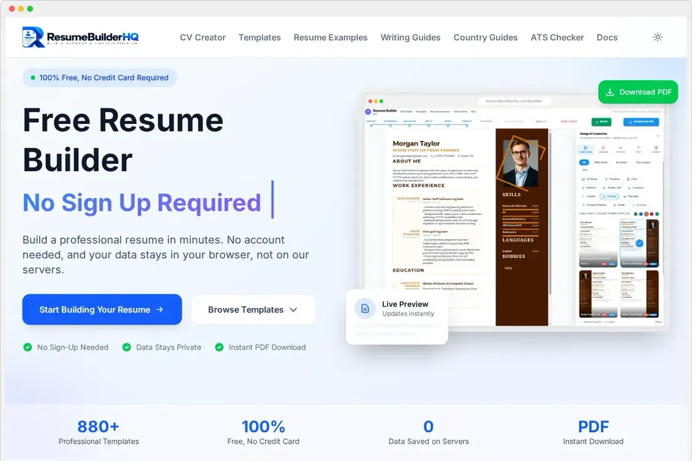
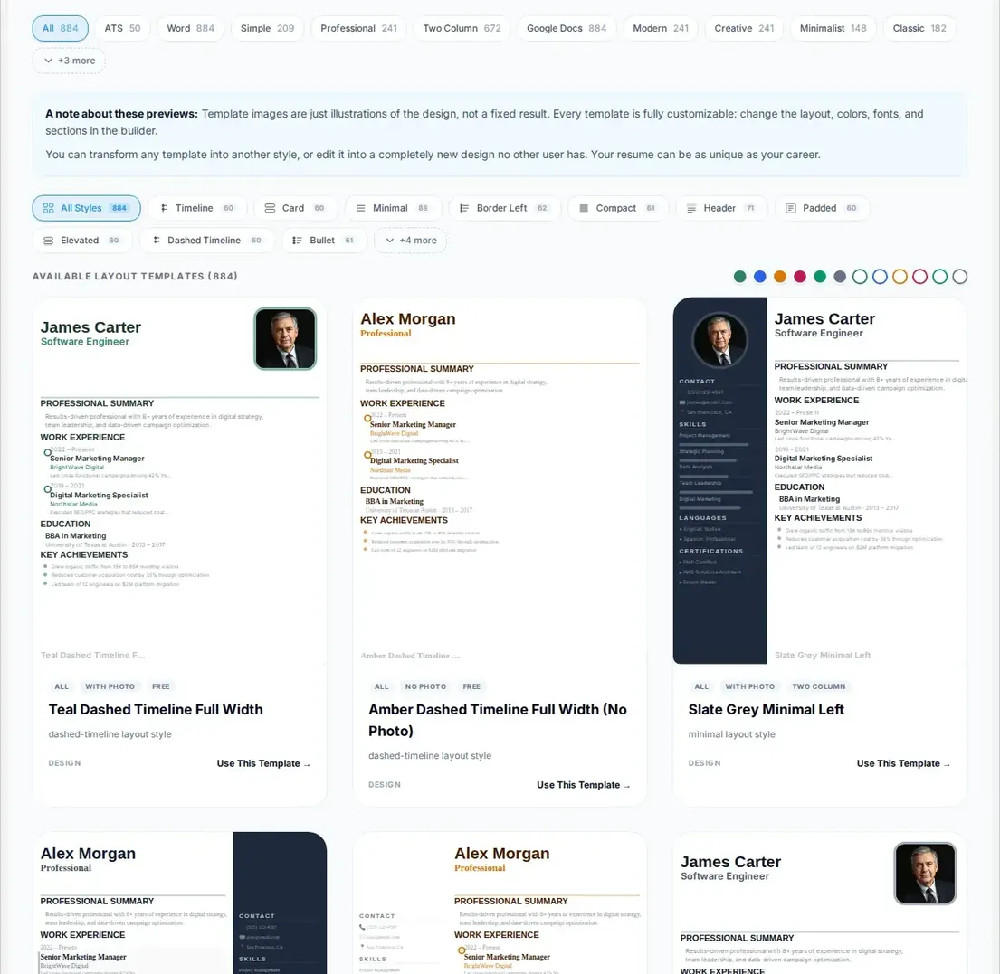
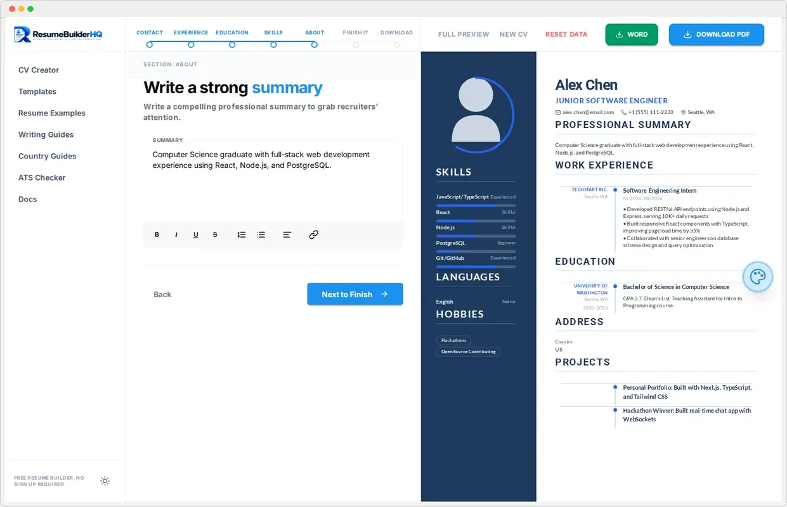
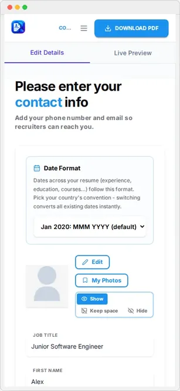
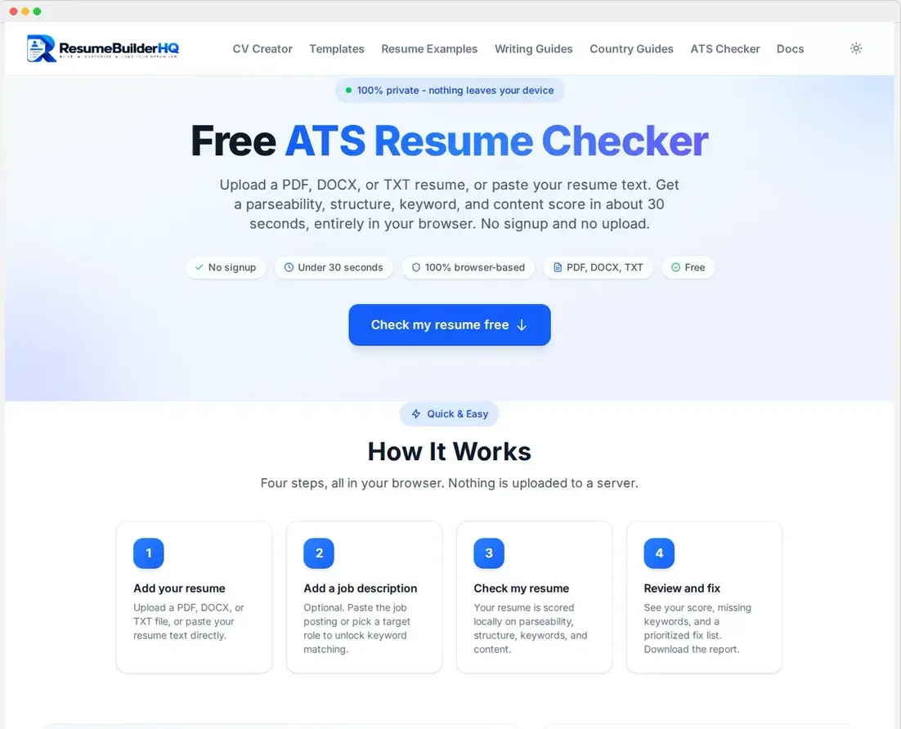
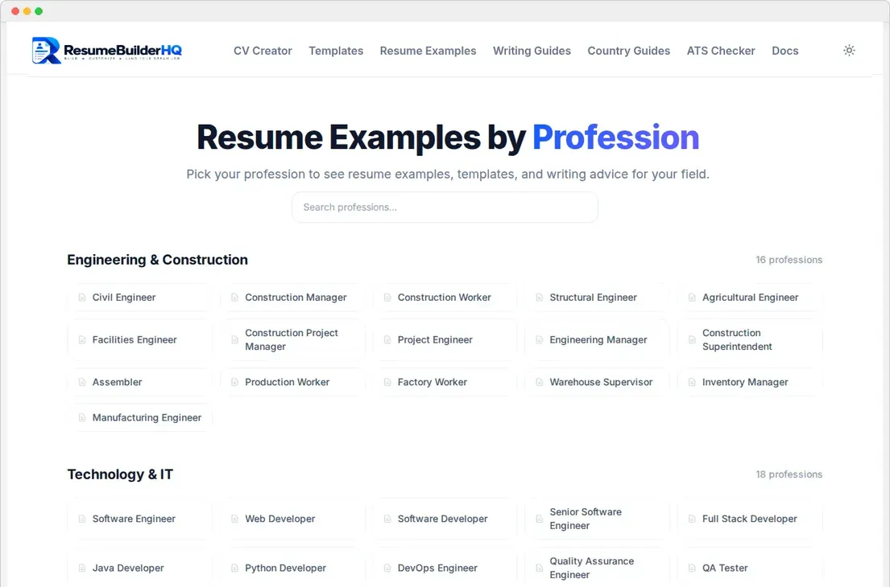
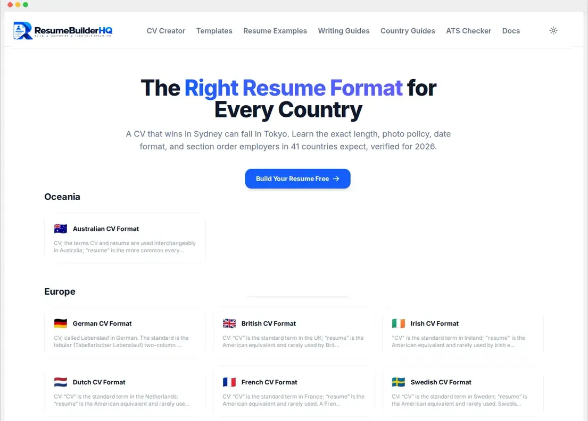
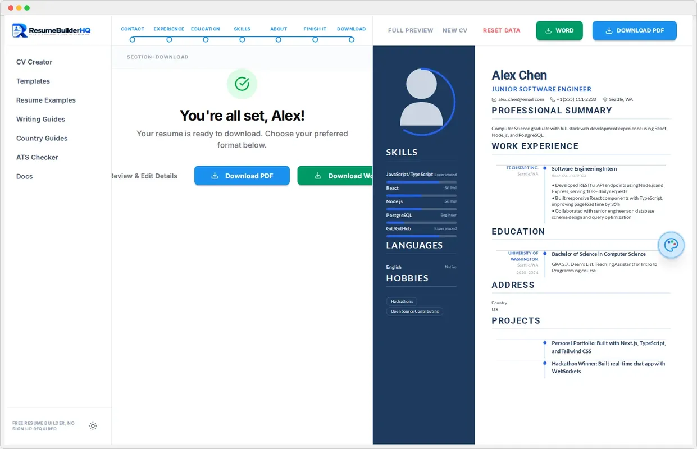

# ✨ Free Resume Builder - No Sign-Up, No Data Leaves Your Computer

Build a professional resume in minutes, completely free. Pick a template, fill
in your details, and download a PDF or Word file. No account, no paywall, no
uploading your personal info anywhere.

**Live site:** [Create a free resume online](https://resumebuilderhq.com/)

---

## 🛡️ Your Data Stays on Your Computer

This is the part most resume builders get wrong, so we built it the right way.

- Everything runs in your browser. We never upload or access your data.
- Your resume never touches our servers.
- Clear everything instantly with one button.

No sign-up. No credit card. No data collection. If closing the tab feels safer,
nothing about you was saved anywhere but your own machine.

---

## ✅ Features You Actually Get for Free

- **880+ ATS-friendly templates.** Modern, minimalist, two-column, with-photo,
  and more. Color schemes for every industry.
- **A 7-step builder wizard.** Contact, experience, education, skills, summary,
  review, download. Live preview the whole time.
- **Free ATS resume checker.** Test your resume against applicant tracking
  systems before you apply.
- **Free resume examples by profession.** Real, editable examples for
  [171 professions](https://resumebuilderhq.com/resume-examples/) at entry,
  mid, and senior level.
- **Resume format guides by country.** Follow the exact convention for
  [41 countries](https://resumebuilderhq.com/resume-format/), including the UK,
  Germany, Australia, and the UAE.
- **PDF and Word download.** Export a clean A4 or US Letter PDF, or a .docx
  file. The PDF keeps a real text layer so ATS scanners can read it.
- **Full design control.** Adjust colors, fonts, section styles, margins, and
  photo options. Fit everything on one page.

See the [free resume builder](https://resumebuilderhq.com/builder/) in action,
or browse all [resume templates](https://resumebuilderhq.com/resume-templates/).

---

## 📄 Free Resume Examples for Every Job

Stuck on wording? Start from a real example and make it yours.

- [Free resume examples by profession](https://resumebuilderhq.com/resume-examples/)
- [Resume writing guides and career advice](https://resumebuilderhq.com/resume-guides/)
- [Country-specific CV formats](https://resumebuilderhq.com/resume-format/)
- [Free ATS resume checker](https://resumebuilderhq.com/ats-resume-checker/)

Engineer, nurse, teacher, truck driver, accountant, retail, admin, hospitality.
If you have a job, there is a resume example for it. Each one shows the exact
sections, skills, and phrasing recruiters expect.

---

## 🌍 Resume Formats for 41 Countries

A resume that works in the US may be wrong for Germany. Resume Builder HQ
includes country-specific CV guides so you match local expectations.

- UK and Australia. Cover letters and referee sections.
- Germany and Europe. Tabular CVs with dates, certifications, and photo rules.
- UAE and Saudi Arabia. Formatting, personal details, and expectations.
- India, Singapore, and more.

Find your format in the [resume format by country](https://resumebuilderhq.com/resume-format/)
section.

---

## 🧑‍💻 Who Is This For?

- **Job seekers** who want a clean resume tonight, not next week.
- **Students and graduates** with little experience who need structure.
- **Career changers** who need to reframe their skills.
- **Anyone worried about privacy** and tired of account walls.

No prior design skill needed. The templates do the layout work. You just fill
in your story.

---

## ✅ Do's and Don'ts for a Strong Resume

**Do:**

- Keep it to one page when you have under 10 years of experience.
- Use the ATS checker to catch formatting that scanners will miss.
- Match your skills to the job description. Use their keywords.
- Quantify your wins. "Cut costs 15%" beats "saved money."

**Don't:**

- Don't use tables, text boxes, or images that ATS software cannot parse.
- Don't list a generic objective that says nothing about you.
- Don't hide your dates. Recruiters notice.
- Don't upload your real resume to random online tools. Keep it local.

For deeper help, read the [resume writing guides](https://resumebuilderhq.com/resume-guides/).

---

## 🖼️ Screenshots

**Homepage and template gallery**

**The builder**

**ATS checker and examples**

---

## 🔗 Quick Links

| What you need | Where to go |
|---|---|
| Create a resume for free | [Free resume builder](https://resumebuilderhq.com/builder/) |
| Browse designs | [880+ resume templates](https://resumebuilderhq.com/resume-templates/) |
| Get a resume example | [Resume examples by profession](https://resumebuilderhq.com/resume-examples/) |
| Get career advice | [Resume writing guides](https://resumebuilderhq.com/resume-guides/) |
| Match local conventions | [Resume format by country](https://resumebuilderhq.com/resume-format/) |
| Catch ATS problems | [Free ATS resume checker](https://resumebuilderhq.com/ats-resume-checker/) |
| Read the documentation | [Resume builder docs](https://resumebuilderhq.com/docs/) |
| Our privacy promise | [Privacy policy](https://resumebuilderhq.com/privacy-policy/) |

---

Made with care. Built for job seekers. Free, with your data where it
belongs - on your computer.

**[Start building your resume for free](https://resumebuilderhq.com/)** 🚀